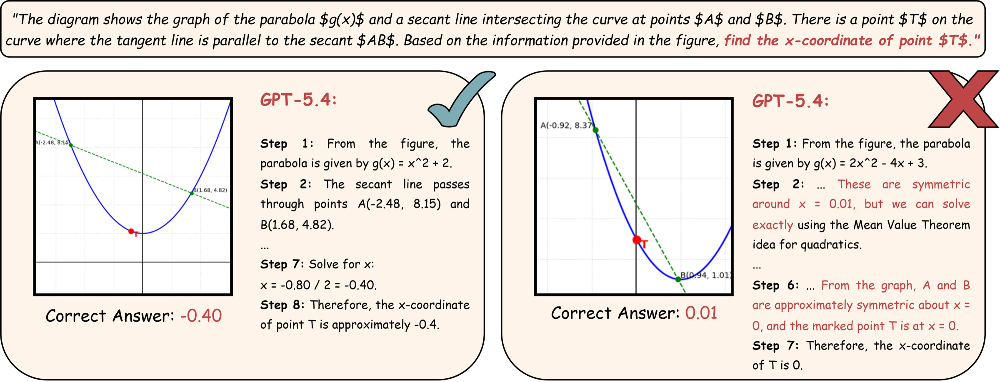
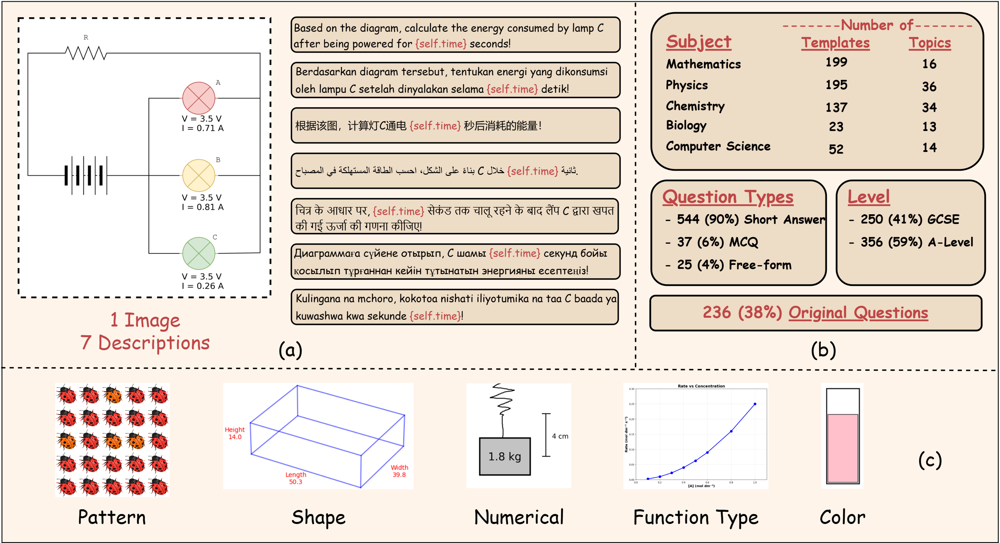

<div align="center">

# Sci-ρ: A Multilingual Visually-Grounded Symbolic Benchmark for STEM Problems

**Muhammad Falensi Azmi**<sup>1\*</sup>, **Ikhlasul Akmal Hanif**<sup>1\*</sup>, Vallerie Alexandra Putra<sup>2</sup>, Adi Yeltay<sup>1</sup>, Abdullah Mubarak<sup>3</sup>, Fajri Koto<sup>1</sup>

<sup>1</sup>MBZUAI &nbsp; <sup>2</sup>Binus University &nbsp; <sup>3</sup>Bandung Institute of Technology &nbsp; <sup>\*</sup>Equal contribution

[](https://falensiazmi.github.io/sci-rho/)
[](https://arxiv.org/abs/2606.08034)
[](https://huggingface.co/datasets/ikhlasulakmalh/sci-rho)
[](https://huggingface.co/datasets/ikhlasulakmalh/sci-rho-results)

</div>

<p align="center">
  
</p>

## Overview

Symbolic benchmarks test whether a model can solve *every* version of a problem, not just the one it was shown. Existing ones are mostly limited to English mathematics without images. **Sci-ρ** (Science Rhobustness) is a dynamic benchmark for visually-grounded STEM problems:

- **5 subjects**: mathematics, physics, chemistry, biology, computer science (GCSE and A-Level)
- **7 languages**: English, Arabic, Chinese, Hindi, Indonesian, Kazakh, Swahili
- **606 templates per language**, written as executable Python by domain experts, including Olympiad medalists
- **42,420 instances**: each template generates variants that change numbers, visual patterns, shapes, colour schemes and function types, each with a ground-truth answer and step-by-step reasoning

We evaluate 17 VLMs and find a large gap between **average-case accuracy** and **worst-case accuracy** (a template counts only if every variant is answered correctly). Smaller open-weight models also degrade in non-English languages, while proprietary and larger models stay robust. Step-level evaluation of the reasoning shows the same gap.

<p align="center">
  
</p>

## Data

| Repository | Contents |
|---|---|
| [`ikhlasulakmalh/sci-rho`](https://huggingface.co/datasets/ikhlasulakmalh/sci-rho) | The benchmark: 6,060 problems (606 templates × 10 variants), each with an image, answer, reasoning, and the question in 7 languages. Also includes the raw `sample/` folders the evaluation scripts read. |
| [`ikhlasulakmalh/sci-rho-results`](https://huggingface.co/datasets/ikhlasulakmalh/sci-rho-results) | Responses from all 17 models, processed metrics, and step-level judge outputs. |

```python
from datasets import load_dataset

ds = load_dataset("ikhlasulakmalh/sci-rho", split="test")
print(ds[0]["question_english"], ds[0]["answer"])
```

## Setup

The code uses Python 3.11 and [uv](https://docs.astral.sh/uv/).

```bash
git clone https://github.com/falensiazmi/sci-rho.git
cd sci-rho
uv sync
```

## Generate problems

Each template is a Python class that draws its figure and computes the answer from randomly sampled parameters. To generate 10 multilingual variants of every template, as in the paper:

```bash
cd dataset_generator
uv run generate_dataset.py --subject all --multi --exp --seed 6186825
```

Output goes to `experiment/sample/<instance>/<subject>/`. Use a different `--seed` to get a fresh set of variants. See [dataset_generator/README.md](dataset_generator/README.md) for all options.

## Evaluate models

To evaluate on the released data, download `sample/` from the Hugging Face dataset into `experiment/sample/`:

```bash
uv run hf download ikhlasulakmalh/sci-rho --repo-type dataset --include "sample/*" --local-dir experiment
```

| Script | Models |
|---|---|
| `experiment/eval_runpod.py` | Open-weight models with vLLM |
| `experiment/eval_gpt.py` | OpenAI Batch API |
| `experiment/eval_gemini.py` | Gemini Batch API |
| `experiment/eval_openrouter.py` | Any model on OpenRouter |

API keys are read from `experiment/secrets/` (not tracked by git), for example `experiment/secrets/openai_api_key.txt`. Flags, inputs and outputs for each script are in [experiment/README.md](experiment/README.md).

## Repository structure

```
dataset_generator/   Problem templates per subject and the generation script
experiment/          Evaluation scripts, prompts, analysis notebooks, table builders
docs/                Project page (GitHub Pages)
```

## Citation

```bibtex
@article{azmi2026scirho,
  title   = {Sci-Rho: A Multilingual Visually-Grounded Symbolic Benchmark for STEM Problems},
  author  = {Azmi, Muhammad Falensi and Hanif, Ikhlasul Akmal and Putra, Vallerie Alexandra and Yeltay, Adi and Mubarak, Abdullah and Koto, Fajri},
  journal = {arXiv preprint arXiv:2606.08034},
  year    = {2026}
}
```
